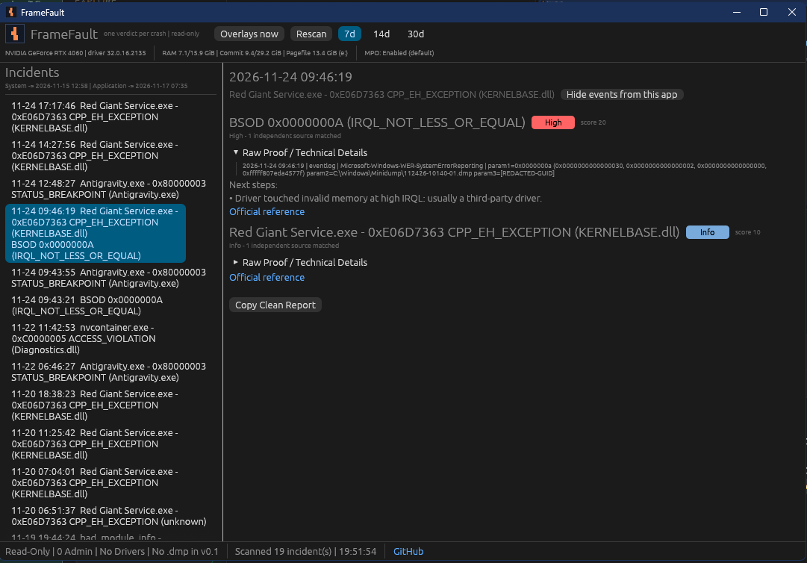
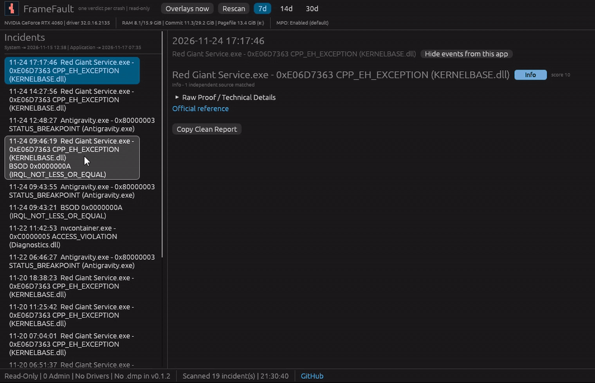

# FrameFault

**One clear verdict for every game crash — for gamers, not sysadmins.**

[](../../releases/latest)
[](../../releases/latest)
[](../../actions/workflows/ci.yml)
[](LICENSE)
[](#requirements)

FrameFault reads the crash evidence Windows already keeps — Event Log, WER reports, Unreal and Unity logs — and turns it into one plain-English verdict, with the evidence and the next steps. Portable, read-only, no admin rights.



## Download

**[Download the latest release](../../releases/latest)** · Windows 10/11 (64-bit)

Unzip `framefault-v*-win64.zip`, run `framefault.exe`, and drop a crash folder — or a `.wer`, `.xml` or `.log` file — onto the window. FrameFault also scans Windows crash logs automatically on launch. When you have a verdict, **Copy Clean Report** puts an anonymous Markdown report on your clipboard.

No installation. No admin/UAC. No drivers. No telemetry.

## Why FrameFault?

Windows already records why a game crashed — across Event Viewer, WER folders and engine logs. Reading it means knowing which provider, event ID and timestamp matters. FrameFault does that correlation for you and gives you one answer instead of a wall of noise.

- **One verdict, not a data dump.** The newest crash is the anchor; related signals within ±15 seconds are grouped into one incident.
- **Evidence you can check.** Every verdict has a timestamped `Raw Proof` chain and an official Microsoft/vendor link.
- **Next steps that make sense.** Remove the overclock, update the driver, disable MPO — not "reinstall Windows".
- **Safe to share.** Usernames, computer names, SIDs, local IPs, GUIDs and serial-like tokens are irreversibly redacted before the report reaches your clipboard.

## See it in action



## Example verdict

```text
Verdict      NVIDIA GPU driver timeout (TDR) — the game did not crash on its own
Confidence   High · 3 independent sources
Evidence     nvlddmkm Event 153 · 21:14:07
             WER Report.wer · 21:14:12
             Game log · 21:14:09
Next steps   Remove GPU overclock / undervolt
             Update or roll back the driver
             Try disabling MPO
```

## What it reads

| Source | What it adds |
|---|---|
| Windows Event Log (System + Application) | GPU timeouts (TDR), WER events, application errors, BSOD codes |
| WER `Report.wer` (UTF-16LE / UTF-8) | Faulting module, exception code, loaded modules, overlay DLLs |
| Unreal `CrashContext.runtime-xml` | Engine crash context, GPU and device information |
| Unity `Player.log` and generic game logs | Engine errors, device-lost messages, the last lines before the crash |
| Windows hardware context | GPU and driver version, RAM/commit/pagefile, MPO state, live overlays |

## Privacy & safety

- **100% read-only.** No admin/UAC, no kernel drivers, no registry edits, no `.dmp` parsing in this release.
- **Nothing is uploaded.** There is no telemetry and no network upload; the clean report goes to your clipboard and you choose where to paste it.
- **No game hooks.** FrameFault does not inject into, hook or modify game processes. It reads crash logs after the fact.
- **Irreversible redaction.** Usernames, computer names, SIDs, local IPs, GUIDs and serial-like tokens are removed before the report leaves the app. Hardware facts are kept because they matter for diagnosis.

## FAQ

**Do I need admin rights?**  
No. FrameFault only reads files and event logs your user account can already see.

**Does it upload my logs?**  
No. The clean report is copied to your clipboard; nothing is sent anywhere.

**Will it get me banned?**  
It does not touch the running game — no injection, no DirectX hooks, no file modification. It only reads crash evidence after the crash.

**Does it read `.dmp` files?**  
Not in this release. v0.1.x works with Event Log, WER, Unreal/Unity logs and game logs.

**Does it fix the crash?**  
No. It tells you the most likely cause and what to try next.

**Which Windows?**  
Windows 10 or 11, 64-bit.

## Honest boundaries

FrameFault is 100% read-only and never guesses. If the Event Log ring buffer no longer reaches the crash time, it shows the real depth (`System log reaches back to: ...`) instead of claiming "no crash found". Historical WER overlay evidence is labelled as historical, and live overlay processes as "now, not crash time" — the two are never mixed.

## How correlation works

1. **Collect** read-only signals from Event Log, WER, Unreal XML, Unity/game logs and Windows hardware context.
2. **Anchor** on the newest crash event, then group all signals within ±15 seconds.
3. **Correlate** by time, process and module; deduplicate and rank independent sources.
4. **Explain** each cause with a timestamped evidence chain, confidence, official links and next steps.
5. **Redact** irreversibly before any report leaves the app.

## Requirements

- Windows 10 or 11, 64-bit.
- No installation, no admin rights, no drivers.
- The release is a portable `.exe`; the zip also includes the MIT license.

## Build from source

```powershell
cargo test
cargo clippy --all-targets -- -D warnings
cargo build --release
```

Run these from the repository root. Release profile: `opt-level="z"`, `lto="fat"`, `strip="symbols"`, `panic="abort"`, single codegen unit, `windows_subsystem="windows"`, eframe with `glow` only.

Rules and official references live in `rules.toml` (embedded into the binary at compile time — no extra file needed to run).

## License

MIT. See [LICENSE](LICENSE).
